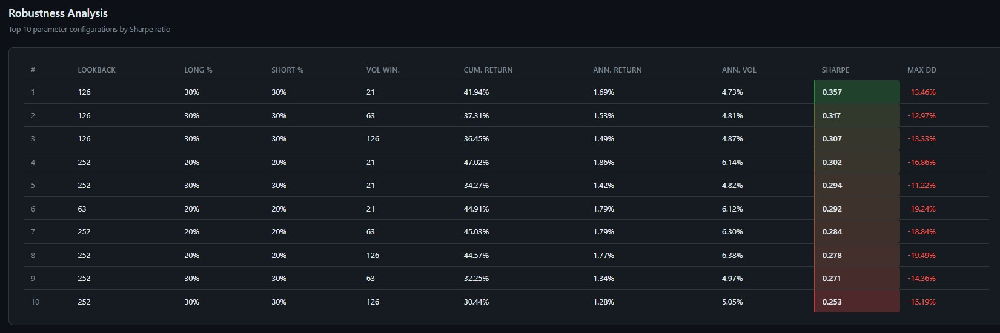

# TradeAlgorithm


**An end-to-end systematic trading research pipeline**: from raw market data to signal generation, walk-forward validation, risk management and automated paper-trading execution via Alpaca.

---

## Overview

TradeAlgorithm started as a **cross-sectional momentum strategy** on a universe of 24 ETFs spanning global equities, fixed income, commodities and alternatives. Walk-forward validation showed that this first design did not work out of sample (Sharpe ratio of -0.11), and the repository documents why.

The second generation, described below, keeps the same pipeline and replaces the strategy with three components:

1. a **core sleeve** that follows a blended time-series trend on the ETF universe, with risk budgeting and volatility targeting (`trend_strategy.py`);
2. a **thematic sleeve** that holds a volatile equity theme, by default AI and semiconductor stocks, under volatility and trend controls (`thematic_sleeve.py`);
3. a **risk overlay** on the whole account that reduces exposure gradually in drawdowns and restores it on recovery (`risk_management.py`).

The project is designed as a rigorous research prototype rather than a production system. Results are reported net of costs, against passive benchmarks, with a robustness table over neighbouring parameters and a Deflated Sharpe Ratio. Negative findings are documented with the same detail as positive ones, including a study that rejects short-window momentum in semiconductor stocks (`short_horizon_study.py`).

---

## Strategy

### Core sleeve: blended trend

Time-series momentum (Moskowitz, Ooi & Pedersen, 2012) judges each asset against its own past: an asset whose return over the lookback is positive is held, otherwise it is replaced by cash. Unlike cross-sectional momentum it needs no short leg and does not require the assets to be comparable with each other.

```
1. TREND     for each ETF, count how many of the 3, 6 and 12 month returns
             are positive; the score is that fraction (0, 1/3, 2/3 or 1)

2. TILT      inside each asset class, rank the ETFs by volatility-adjusted
             trend; the strongest gets 1.5x its base weight, the weakest 0.5x

3. BUDGET    weight by inverse volatility inside each asset class and scale
             the three classes to similar ex-ante risk

4. TARGET    scale the book to 10 % annualised volatility using the 63-day
             covariance matrix, capped at 100 % gross (no leverage);
             the remainder is held in SHY

5. STAGGER   hold the average of five sub-portfolios, each rebalanced on a
             different day of the week; skip trades below 2 % of the book
```

No parameter is selected by backtest performance. The three lookbacks are averaged instead of choosing the best one, which removes the parameter instability documented for the original strategy.

### Thematic sleeve

The sleeve takes a list of stocks (`data/universe_thematic.csv`) as a given, discretionary view and decides how much of each to hold:

```
exposure = min(1, 30 % / realised 21-day volatility)
           x (0.25 + 0.75 x fraction of 3, 6, 12 month returns that are positive)

weight   = exposure / number of stocks          (rebalanced weekly)
```

A stock in a full downtrend keeps a quarter of its base exposure instead of being sold, because sharp recoveries are frequent in this sector and a complete exit misses them.

### Risk overlay

Applied in `daily_execution.py` on the account equity:

| Rule | Behaviour |
|---|---|
| Equity sanitisation | A print that moves more than 15 % and reverts on the next run is discarded. An unconfirmed jump on the current day means no orders that day. |
| Drawdown scaling | Exposure is 100 % above a 5 % drawdown from the 252-run peak and falls linearly to 35 % at 10 %. It rises again as the account recovers. |
| Volatility scaling | Exposure is multiplied by `min(1, 10 % / realised 63-run volatility)`. |
| Kill-switch | At a 20 % drawdown the account moves to cash for 21 runs, then re-arms with a fresh reference peak and re-enters at 35 % exposure. |

---

## Pipeline

```
Yahoo Finance (ETF universe + thematic stocks, daily, from 2003/2005)
        │
        ▼
┌─────────────────────┐
│  trade_algorithm.py │  Download & validate prices, filter by liquidity
│  loaders/           │  Save adjclose_wide, prices_long, volume_wide CSVs
└─────────────────────┘
        │
        ├──────────────────────────────┬──────────────────────────────┐
        ▼                              ▼                              ▼
┌────────────────────┐      ┌─────────────────────┐      ┌───────────────────────┐
│ trend_strategy.py  │      │ thematic_sleeve.py  │      │ Legacy research       │
│                    │      │                     │      │                       │
│ Blended trend,     │      │ Volatility scaling  │      │ signal_generation.py  │
│ risk budget,       │      │ and trend gate on   │      │ universe_segments.py  │
│ vol target,        │      │ a stock theme       │      │ walk_forward.py       │
│ staggered rebal.   │      │                     │      │ robust_evaluation.py  │
└────────────────────┘      └─────────────────────┘      │ ml_strategy.py        │
        │                              │                 └───────────────────────┘
        └──────────────┬───────────────┘
                       ▼
        ┌──────────────────────────┐
        │   risk_management.py     │  Equity sanitisation, drawdown and
        │                          │  volatility scaling, kill-switch
        └──────────────────────────┘
                       │
                       ▼
        ┌──────────────────────────┐
        │   daily_execution.py     │  Targets → Alpaca Paper API → orders
        │                          │  Logs → data/live/logs/daily_execution.jsonl
        └──────────────────────────┘
                       │
                       ▼
        ┌──────────────────────────┐
        │   dashboard_server.py    │  Flask web UI: equity curve, positions,
        │   templates/             │  robustness table, execution logs
        └──────────────────────────┘

Research modules that do not feed execution:
  short_horizon_study.py   tests short-window momentum and reversal
  performance_metrics.py   Sharpe, Sortino, Calmar, PSR, Deflated Sharpe, bootstrap
```

---

## Research Findings

> **This section documents results honestly. Transparency about what works and what does not is a prerequisite for sound quantitative research.**

### 1. Original strategy: walk-forward results (16 windows, 2010 to 2026)

Walk-forward validation was performed with a 5-year training window and a 1-year out-of-sample test window, advancing annually. Parameters were selected by Sharpe ratio on the training data alone and applied without modification to the test period.

| Metric | Cross-sectional (all ETFs) | Segmented by asset class |
|---|---|---|
| OOS Sharpe ratio | **-0.11** | **+0.31** |
| Annualised return (OOS) | -1.2 % | +3.3 % |
| Max drawdown (OOS) | -39.7 % | -24.3 % |
| Positive windows | 6 of 16 | 11 of 16 |

Ranking inside homogeneous groups helps, which confirms that comparing a commodity ETF with a government bond ETF mixes unrelated return drivers. The result is still weak. A review of the code found the reasons:

**1. The short leg.** With 18 to 24 broad ETFs the "losers" are whole asset classes. Shorting them means paying their risk premium. The long-short variant of the new strategy has a Sharpe ratio of 0.39 against 0.53 for long or flat.

**2. Selection of a single lookback.** The lookback chosen in training alternated between 126 and 252 days. Picking the best of twelve noisy in-sample Sharpe ratios is selection bias; the chosen value carried little information about the next year.

**3. Daily re-ranking.** Positions were recomputed every day from a signal that changes slowly, which produced turnover without information.

**4. The live system did not trade the backtested strategy.** `daily_execution.py` ran with `long_only=True`, which discarded the short leg and renormalised the long leg, so the paper account followed a strategy that had never been tested.

**5. A drawdown stop that never released.** The stop used the worst drawdown in the whole equity history. On 17 September 2026 the broker reported an equity of 74,518 between two days at about 96,000. That single erroneous print put the system in a permanent halt: it has not traded since, while the positions held on that date kept drifting.

**6. A market-impact formula that returned zero.** The participation rate divided a portfolio weight by a dollar volume, so the modelled cost was negligible for any trade. The formula now multiplies by the capital traded.

### 2. Core sleeve: blended trend

Evaluated on the same data and period (2010-01 to 2026-02), net of 5 bps per trade, Sharpe ratio measured over the return of SHY:

| Metric | Blended trend | Equal weight, buy and hold | 60/40 (IWF, IWD, TLT) |
|---|---|---|---|
| Sharpe ratio | **0.53** | 0.55 | 0.87 |
| Annualised return | 4.2 % | 6.9 % | 10.2 % |
| Annualised volatility | 5.4 % | 10.6 % | 10.4 % |
| Max drawdown | **-17.0 %** | -27.7 % | -27.5 % |

Reading these numbers correctly matters more than the numbers themselves:

- The strategy is a clear improvement on the original (from -0.11 and +0.31 to +0.53, with a stricter Sharpe definition).
- It does **not** beat holding the universe. It delivers the same Sharpe ratio as the equal-weighted portfolio with half the volatility and a smaller drawdown, and it trails a US 60/40 portfolio, which had one of the best periods in its history.
- The 90 % bootstrap interval of the Sharpe ratio is 0.07 to 1.02. Sixteen years are not enough to pin it down more precisely.
- Realised volatility (5.4 %) is below the 10 % target because the book cannot use leverage and bond ETFs absorb much of the risk budget.

**Robustness.** Twenty neighbouring configurations were evaluated (lookback sets, volatility windows, targets, rebalance frequency, bands, tilts, costs). Sharpe ratios range from 0.31 to 0.58 and the Deflated Sharpe Ratio of the baseline is 0.94. Three sensitivities are worth knowing:

| Variation | Sharpe ratio |
|---|---|
| Baseline | 0.53 |
| Cost of 10 bps instead of 5 | 0.45 |
| 12-month lookback only | 0.31 |
| Long-short instead of long or flat | 0.39 |
| Single weekly rebalance, by weekday | 0.43 to 0.54 |

The last row is the reason for the staggered rebalance: with one rebalance per week the Sharpe ratio moved by 0.1 depending only on the weekday chosen, which is luck and not a property of the strategy.

### 3. Short-window momentum in semiconductors

**Hypothesis.** Semiconductor and AI stocks move in rallies and corrections of two or three days. Entering after strength and leaving two days later, or leaving on the first weak day, should capture much of the upside.

**Test.** `short_horizon_study.py`, daily data to 13 November 2026, signal at the close, execution at the next open, 5 bps per switch.

Average next-day return of SMH since 2005:

| Condition | Next-day return | t-statistic |
|---|---|---|
| After an up day | 0 bps | -0.1 |
| After a down day | +18 bps | 4.5 |
| After a three-day rise above 1.5 standard deviations | +6 bps | 0.7 |
| After a three-day fall below -1.5 standard deviations | +37 bps | 3.0 |

Sharpe ratio of "hold SMH when its k-day return is positive, otherwise cash":

| Rule | Since 2005 | Since 2016 | Since 2023 | 2026 to date |
|---|---|---|---|---|
| Buy and hold | 0.63 | 0.93 | 1.19 | 0.83 |
| k = 1 day | -0.37 | -0.21 | 0.08 | 0.40 |
| k = 2 days | -0.10 | 0.15 | 0.58 | 0.78 |
| k = 3 days | 0.04 | 0.20 | 0.69 | 1.23 |
| k = 5 days | -0.02 | 0.25 | 0.46 | -0.22 |
| k = 10 days | 0.49 | 0.82 | 1.14 | 0.98 |
| k = 63 days | 0.61 | 0.88 | 1.14 | 0.97 |
| k = 126 days | 0.59 | 0.87 | 1.22 | 0.99 |

Across 19 large semiconductor stocks since 2005, rules with k between 1 and 5 days beat buy and hold in 0 or 1 stocks, with a median Sharpe ratio between -0.05 and 0.18 against 0.57 for holding.

**Conclusion.** The hypothesis is rejected. At horizons of one to five days the sector mean-reverts: the day after a fall is, on average, the good day, and the day after a rise is flat. This agrees with the literature, where short-horizon continuation appears at the one-month horizon for industries and high-turnover stocks (Medhat & Schmeling, 2022; Gao, Li, Yuan & Zhou, 2026) and not at the horizon of days, where reversal dominates (Lehmann, 1990).

In 2026 the 2-day and 3-day rules did roughly match buy and hold on SMH with a smaller drawdown, which explains the impression. The 5-day rule lost money over the same months. A result that changes sign between k = 3 and k = 5 on 218 observations is noise, and a rule that trades 60 to 80 times a year also carries broker, currency and tax costs that the 5 bps assumption does not cover.

### 4. Thematic sleeve

Equal-weighted basket of the 19 stocks in `data/universe_thematic.csv`, data to 13 November 2026, 5 bps per trade:

| Period | Portfolio | Sharpe | Annualised return | Volatility | Max drawdown |
|---|---|---|---|---|---|
| Since 2006 | Sleeve | 0.75 | 13.7 % | 16.6 % | -25 % |
| | Basket, buy and hold | 0.74 | 22.4 % | 32.3 % | -67 % |
| Since 2016 | Sleeve | 0.97 | 20.4 % | 18.6 % | -22 % |
| | Basket, buy and hold | 0.97 | 34.9 % | 34.6 % | -44 % |
| Since 2023 | Sleeve | 1.22 | 30.3 % | 19.6 % | -18 % |
| | Basket, buy and hold | 1.18 | 52.2 % | 37.7 % | -40 % |

The sleeve has the same Sharpe ratio as holding the basket. It does not add return per unit of risk; it halves the risk and cuts the worst drawdown from -67 % to -25 %. The same holds for SMH, QQQ and a set of 22 sector ETFs. Trend and volatility rules on equities are risk management, and should be judged as such.

Two caveats. The 19 tickers are today's survivors, so the return of the basket is overstated; the comparison between sleeve and basket is the valid claim. A five-day reversal tilt (buy more after falls) looked promising on single assets and with daily trading, but added nothing at a weekly rebalance and is disabled by default.

### 5. What did not help

| Idea | Result |
|---|---|
| Cross-sectional momentum across 22 sector and industry ETFs (top 5 of 22) | Sharpe 0.21 to 0.53 depending on lookback, against 0.53 for equal weight (2008 to 2026) |
| One-month lookback in the trend blend | Turnover up by half, Sharpe from 0.53 to 0.48 |
| Trend state as a return forecast (bull, correction, bear, rebound) | Sharpe ratios by state between 0.6 and 0.7 for SMH; what differs across states is volatility (25 % to 40 %), not return per unit of risk |

---

## Architecture

| Module | Role |
|---|---|
| `trade_algorithm.py` | Downloads OHLCV data from Yahoo Finance; applies liquidity filters (min $500k daily volume, $200M AUM); saves `adjclose_wide`, `prices_long`, and `volume_wide` CSVs |
| `loaders/price_loader.py` | `PriceDownloadConfig` dataclass; `download_prices_adjclose`, `quality_checks_prices`, `save_prices_panel` |
| `feature_engineering.py` | Log returns (5 horizons), rolling volatility (3 windows), rolling drawdown, 200-day MA trend flag, cross-sectional percentile ranks |
| `trend_strategy.py` | **Core strategy.** Blended trend score, within-sleeve relative strength, risk budgeting, volatility targeting, staggered rebalance, no-trade band; robustness grid and Deflated Sharpe Ratio |
| `thematic_sleeve.py` | **Thematic sleeve.** Volatility scaling and trend gate on the stocks of `data/universe_thematic.csv`; comparison against the buy-and-hold basket |
| `risk_management.py` | Equity sanitisation, current-drawdown scaling, volatility scaling, self re-arming kill-switch |
| `performance_metrics.py` | Excess-return Sharpe, Sortino, Calmar, Probabilistic and Deflated Sharpe Ratio, block-bootstrap confidence interval |
| `short_horizon_study.py` | Tests short-window momentum and reversal with next-open execution |
| `daily_execution.py` | Orchestrates the daily pipeline; `strategy="trend"` (default) or `"legacy"`; risk overlay; submits market orders via Alpaca SDK |
| `signal_generation.py` | Legacy: cross-sectional momentum signals and volatility-scaled weights |
| `universe_segments.py` | Legacy: cross-sectional momentum inside asset-class segments |
| `backtester.py` | Legacy backtest with lagged weights; square-root market-impact cost model (`10 × √participation_rate` bps) with 5 bps flat fallback |
| `robust_evaluation.py` | Legacy grid search over (ranking_horizon, top_pct, vol_window) |
| `walk_forward.py` | Rolling 5-year train / 1-year test windows for the legacy strategy |
| `ml_strategy.py` | Logistic regression on per-(date, ticker) feature rows |
| `dashboard_server.py` | Flask API server (port 5050); endpoints for equity, weights, robustness, logs |
| `templates/dashboard.html` | Single-page UI; Chart.js equity curve and positions chart; robustness table; execution log cards |
| `setup_scheduler.ps1` | Configures Windows Task Scheduler to run `run_daily.bat` at 16:30 local time |

---

## Installation

```bash
git clone https://github.com/Rehyvax/TradeAlgorithm.git
cd TradeAlgorithm
pip install -r requirements.txt
```

Create a `.env` file in the project root with your Alpaca Paper Trading credentials:

```
ALPACA_API_KEY=your_key_here
ALPACA_API_SECRET=your_secret_here
```

---

## Usage

```bash
# 1. Download and validate price data
python trade_algorithm.py

# 2. Core strategy: backtest, benchmarks, robustness table
python trend_strategy.py

# 3. Thematic sleeve: backtest against the buy-and-hold basket
python thematic_sleeve.py

# 4. Short-window momentum and reversal study
python short_horizon_study.py

# 5. Daily paper trading execution
python daily_execution.py

# 6. Launch the monitoring dashboard
python dashboard_server.py
# open http://localhost:5050

# Legacy research (original cross-sectional strategy)
python signal_generation.py
python backtester.py
python robust_evaluation.py
python walk_forward.py
python universe_segments.py
python ml_strategy.py
```

To run the original strategy in execution, call `main(strategy="legacy")` in `daily_execution.py`. To change the theme, edit `data/universe_thematic.csv`. To disable the thematic sleeve, call `main(thematic_allocation=0.0)`.

**Scheduled execution.** `.github/workflows/daily_trading.yml` runs `daily_execution.py` on weekdays at 21:30 UTC. On Windows, run `setup_scheduler.ps1` as Administrator to register a Task Scheduler job that fires `run_daily.bat` every day at 16:30 local time.

---

## Dashboard

A Flask web dashboard is available at `http://localhost:5050` after running `dashboard_server.py`.

```
┌────────────────────────────────────────────────────────┐
│  TradeAlgorithm            27 Feb 2026 · $100,000      │
├─────────────┬──────────────────────────────────────────┤
│ Equity Curve│  [Normalised equity curve, Chart.js]     │
│ Positions   │  Total Return   Peak Equity   Drawdown   │
│ Robustness  ├────────────────────────────────────────  │
│ Logs        │  [Positions bar chart, green/red]        │
│ About       ├────────────────────────────────────────  │
│             │  [Robustness table, Sharpe heat-map]     │
└─────────────┴──────────────────────────────────────────┘
```

Sections: **Equity Curve** (normalised equity + total return / peak / drawdown metrics), **Positions** (current weights), **Robustness** (top-10 parameter configs by Sharpe), **Logs** (last 30 execution events with order tags), **About** (strategy explanation and glossary in Spanish).



---

## Limitations

- **Paper trading only.** The system connects exclusively to Alpaca's paper trading environment. Fills are simulated; partial fills and real slippage are not observed.
- **Modest edge.** The core sleeve has a Sharpe ratio near 0.5 with a wide confidence interval and matches, rather than beats, a passive portfolio of the same ETFs. Its value is lower volatility and drawdown.
- **Cost sensitivity.** Turnover is about 9 times the book per year. Doubling the cost assumption from 5 to 10 bps lowers the Sharpe ratio from 0.53 to 0.45.
- **No leverage.** Without leverage the book runs at roughly half of its volatility target.
- **Thematic sleeve is a view, not a signal.** The choice of semiconductors is discretionary and benefits from hindsight. The sleeve only controls its risk.
- **Data.** Prices come from Yahoo Finance. The ETF liquidity filter uses current metadata, which is a mild look-ahead in the historical universe. The thematic results were computed on data to 13 November 2026 and should be regenerated with `thematic_sleeve.py` and `short_horizon_study.py` before being quoted.
- **Design choices were made with knowledge of the full sample.** Parameters are conventional and the robustness table bounds the effect, but the only true out-of-sample test is the paper account from the date this version goes live.

---

## Future Work

| Priority | Extension |
|---|---|
| [done] | Walk-forward validation with parameter selection on train data only |
| [done] | Universe segmentation: momentum applied inside equity, fixed income and alternatives |
| [done] | Blended trend strategy with risk budgeting, volatility targeting and staggered rebalance |
| [done] | Risk overlay with equity sanitisation and a drawdown rule that recovers |
| [done] | Thematic sleeve and short-window momentum study |
| Next | Dashboard panels for the two sleeves and the risk overlay state |
| Next | Unit tests for `risk_management.py` and `trend_strategy.py`, run in the GitHub workflow |
| Next | Managed-futures style universe (rates, currencies and commodities through ETFs) to raise the number of independent trends |
| Next | Short-term reversal as a separate, daily-traded sleeve with limit orders, where the evidence is strongest |
| Next | Point-in-time universe for the thematic sleeve to remove survivorship bias |

---

## References

- Bailey, D., & Lopez de Prado, M. (2014). *The deflated Sharpe ratio.* Journal of Portfolio Management, 40(5), 94-107.
- Barroso, P., & Santa-Clara, P. (2015). *Momentum has its moments.* Journal of Financial Economics, 116(1), 111-120.
- Daniel, K., & Moskowitz, T. (2016). *Momentum crashes.* Journal of Financial Economics, 122(2), 221-247.
- Gao, C., Li, S. Z., Yuan, P., & Zhou, G. (2026). *The anatomy of industry momentum.* SSRN working paper 6371558.
- Goulding, C., Harvey, C., & Mazzoleni, M. (2023). *Momentum turning points.* Journal of Financial Economics, 149(3), 378-406.
- Hoffstein, C., Faber, N., & Braun, S. (2020). *Rebalance timing luck: the (dumb) luck of smart beta.* SSRN working paper 3673910.
- Jegadeesh, N., & Titman, S. (1993). *Returns to buying winners and selling losers.* Journal of Finance, 48(1), 65-91.
- Lehmann, B. (1990). *Fads, martingales, and market efficiency.* Quarterly Journal of Economics, 105(1), 1-28.
- Medhat, M., & Schmeling, M. (2022). *Short-term momentum.* Review of Financial Studies, 35(3), 1480-1526.
- Moreira, A., & Muir, T. (2017). *Volatility-managed portfolios.* Journal of Finance, 72(4), 1611-1644.
- Moskowitz, T., Ooi, Y. H., & Pedersen, L. H. (2012). *Time series momentum.* Journal of Financial Economics, 104(2), 228-250.
- Zakamulin, V. (2026). *Rethinking time-series momentum in equity portfolios: common signals, long-only positioning, and no need for volatility timing.* SSRN working paper 7318318.
- Zarattini, C., & Antonacci, G. (2024). *A century of profitable industry trends.* SSRN working paper.

---

## Disclaimer

This repository is provided for research and educational purposes only. It does not constitute financial advice, investment advice, or a solicitation to buy or sell any financial instrument. Past performance of any strategy documented here is not indicative of future results. All results shown are from backtests and paper trading simulations and do not represent actual investment returns.
