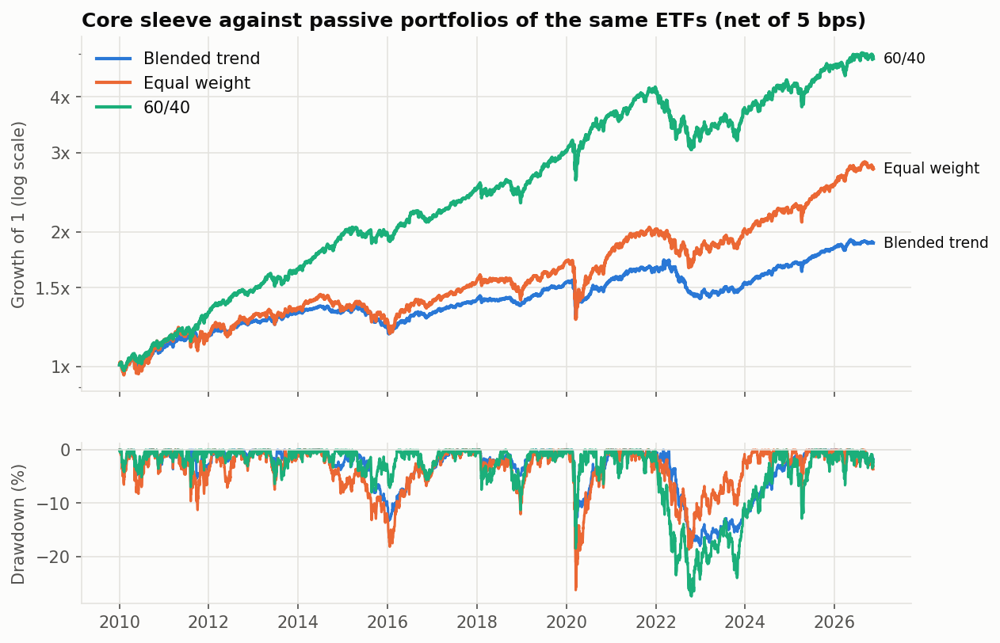
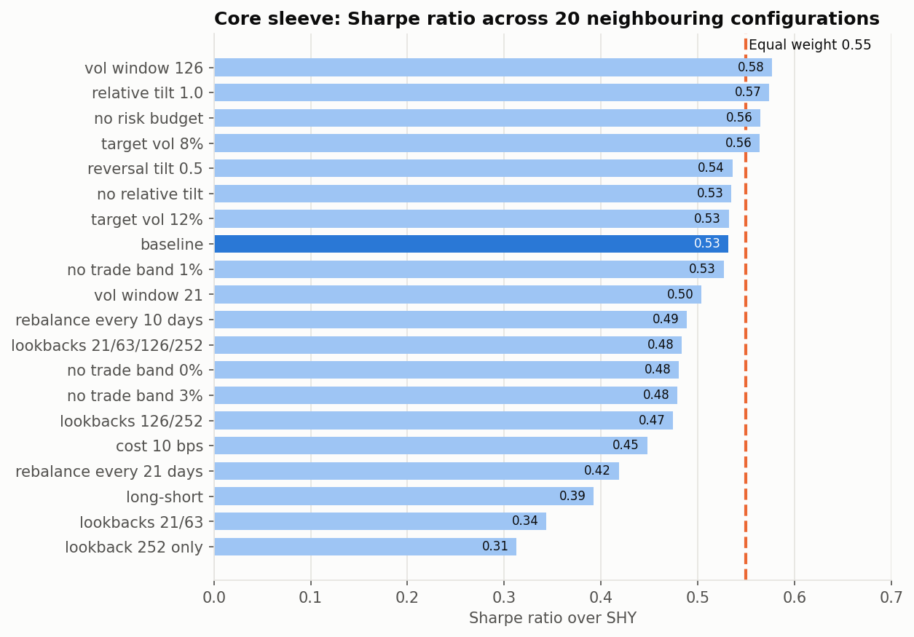
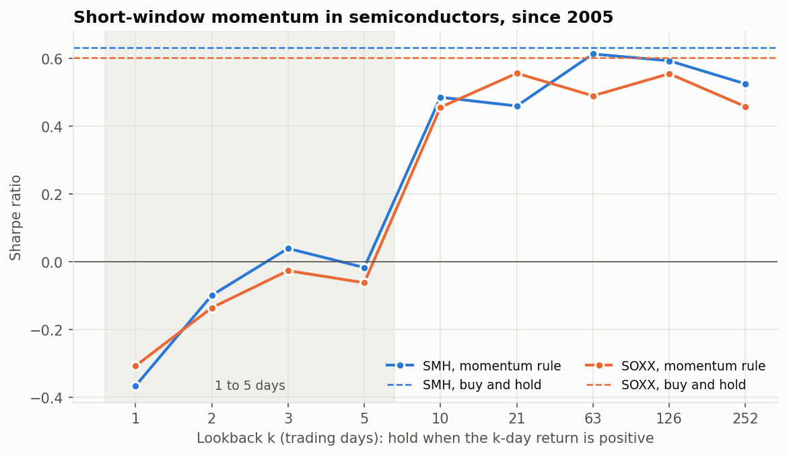
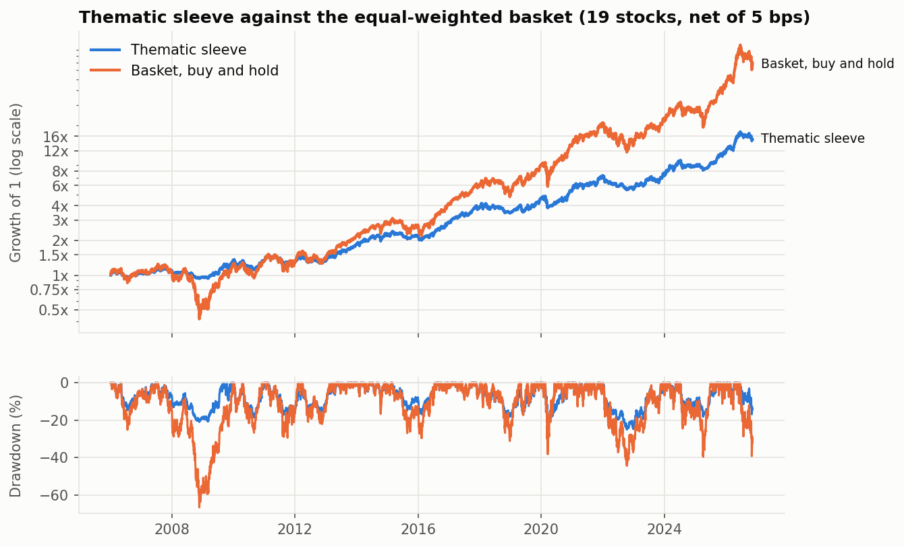

# TradeAlgorithm


**An end-to-end systematic trading research pipeline**: from raw market data to signal generation, walk-forward validation, risk management and automated paper-trading execution via Alpaca.

---

## Overview

TradeAlgorithm started as a **cross-sectional momentum strategy** on a universe of 24 ETFs spanning global equities, fixed income, commodities and alternatives. Walk-forward validation showed that this first design did not work out of sample (Sharpe ratio of -0.11), and the repository documents why.

The second generation, described below, keeps the same pipeline and replaces the strategy with three components:

1. a **core sleeve** that follows a blended time-series trend on the ETF universe, with risk budgeting and volatility targeting (`trend_strategy.py`);
2. a **thematic sleeve** that holds a volatile equity theme, by default AI and semiconductor stocks, under volatility and trend controls (`thematic_sleeve.py`);
3. a **risk overlay** on the whole account that reduces exposure gradually in drawdowns and restores it on recovery (`risk_management.py`).

**Status: research complete.** The conclusions are summarised in [Conclusions](#conclusions); the paper account keeps running as the only true out-of-sample test.

The project is designed as a rigorous research prototype rather than a production system. Results are reported net of costs, against passive benchmarks, with a robustness table over neighbouring parameters and a Deflated Sharpe Ratio. Negative findings are documented with the same detail as positive ones, including a study that rejects short-window momentum in semiconductor stocks (`short_horizon_study.py`).

---

## Strategy

### Core sleeve: blended trend

Time-series momentum (Moskowitz, Ooi & Pedersen, 2012) judges each asset against its own past: an asset whose return over the lookback is positive is held, otherwise it is replaced by cash. Unlike cross-sectional momentum it needs no short leg and does not require the assets to be comparable with each other.

```
1. TREND     for each ETF, count how many of the 3, 6 and 12 month returns
             are positive; the score is that fraction (0, 1/3, 2/3 or 1)

2. TILT      inside each asset class, rank the ETFs by volatility-adjusted
             trend; the strongest gets 1.5x its base weight, the weakest 0.5x

3. BUDGET    weight by inverse volatility inside each asset class and scale
             the three classes to similar ex-ante risk

4. TARGET    scale the book to 10 % annualised volatility using the 63-day
             covariance matrix, capped at 100 % gross (no leverage);
             the remainder is held in SHY

5. STAGGER   hold the average of five sub-portfolios, each rebalanced on a
             different day of the week; skip trades below 2 % of the book
```

No parameter is selected by backtest performance. The three lookbacks are averaged instead of choosing the best one, which removes the parameter instability documented for the original strategy.

### Thematic sleeve

The sleeve takes a list of stocks (`data/universe_thematic.csv`) as a given, discretionary view and decides how much of each to hold:

```
exposure = min(1, 30 % / realised 21-day volatility)
           x (0.25 + 0.75 x fraction of 3, 6, 12 month returns that are positive)

weight   = exposure / number of stocks          (rebalanced weekly)
```

A stock in a full downtrend keeps a quarter of its base exposure instead of being sold, because sharp recoveries are frequent in this sector and a complete exit misses them.

### Risk overlay

Applied in `daily_execution.py` on the account equity:

| Rule | Behaviour |
|---|---|
| Equity sanitisation | A print that moves more than 15 % and reverts on the next run is discarded. An unconfirmed jump on the current day means no orders that day. |
| Drawdown scaling | Exposure is 100 % above a 5 % drawdown from the 252-run peak and falls linearly to 35 % at 10 %. It rises again as the account recovers. |
| Volatility scaling | Exposure is multiplied by `min(1, 10 % / realised 63-run volatility)`. |
| Kill-switch | At a 20 % drawdown the account moves to cash for 21 runs, then re-arms with a fresh reference peak and re-enters at 35 % exposure. |
| Cash budget | Sells and buys are sent together and the buy budget counts the cash the sells will free, less a buffer of 1 % of equity, so a full rebalance completes in one run. |
| Daily lock | A real run writes a lock file and a second real run on the same day exits. Dry runs ignore the lock and can be repeated. |

---

## Pipeline

```
Yahoo Finance (ETF universe + thematic stocks, daily, from 2003/2005)
        │
        ▼
┌─────────────────────┐
│  trade_algorithm.py │  Download & validate prices, filter by liquidity
│  loaders/           │  Save adjclose_wide, prices_long, volume_wide CSVs
└─────────────────────┘
        │
        ├──────────────────────────────┬──────────────────────────────┐
        ▼                              ▼                              ▼
┌────────────────────┐      ┌─────────────────────┐      ┌───────────────────────┐
│ trend_strategy.py  │      │ thematic_sleeve.py  │      │ legacy/ research      │
│                    │      │                     │      │                       │
│ Blended trend,     │      │ Volatility scaling  │      │ signal_generation     │
│ risk budget,       │      │ and trend gate on   │      │ universe_segments     │
│ vol target,        │      │ a stock theme       │      │ walk_forward          │
│ staggered rebal.   │      │                     │      │ robust_evaluation     │
└────────────────────┘      └─────────────────────┘      │ ml_strategy           │
        │                              │                 └───────────────────────┘
        └──────────────┬───────────────┘
                       ▼
        ┌──────────────────────────┐
        │   risk_management.py     │  Equity sanitisation, drawdown and
        │                          │  volatility scaling, kill-switch
        └──────────────────────────┘
                       │
                       ▼
        ┌──────────────────────────┐
        │   daily_execution.py     │  Targets → Alpaca Paper API → orders
        │                          │  Logs → data/live/logs/daily_execution.jsonl
        └──────────────────────────┘
                       │
                       ▼
        ┌──────────────────────────┐
        │   dashboard_server.py    │  Flask web UI: equity curve, positions,
        │   templates/             │  robustness table, execution logs
        └──────────────────────────┘

Research modules that do not feed execution:
  short_horizon_study.py   tests short-window momentum and reversal
  performance_metrics.py   Sharpe, Sortino, Calmar, PSR, Deflated Sharpe, bootstrap
```

---

## Research Findings

> **This section documents results honestly. Transparency about what works and what does not is a prerequisite for sound quantitative research.**

### 1. Original strategy: walk-forward results (16 windows, 2010 to 2026)

Walk-forward validation was performed with a 5-year training window and a 1-year out-of-sample test window, advancing annually. Parameters were selected by Sharpe ratio on the training data alone and applied without modification to the test period.

| Metric | Cross-sectional (all ETFs) | Segmented by asset class |
|---|---|---|
| OOS Sharpe ratio | **-0.11** | **+0.31** |
| Annualised return (OOS) | -1.2 % | +3.3 % |
| Max drawdown (OOS) | -39.7 % | -24.3 % |
| Positive windows | 6 of 16 | 11 of 16 |

Ranking inside homogeneous groups helps, which confirms that comparing a commodity ETF with a government bond ETF mixes unrelated return drivers. The result is still weak. A review of the code found the reasons:

**1. The short leg.** With 18 to 24 broad ETFs the "losers" are whole asset classes. Shorting them means paying their risk premium. The long-short variant of the new strategy has a Sharpe ratio of 0.39 against 0.53 for long or flat.

**2. Selection of a single lookback.** The lookback chosen in training alternated between 126 and 252 days. Picking the best of twelve noisy in-sample Sharpe ratios is selection bias; the chosen value carried little information about the next year.

**3. Daily re-ranking.** Positions were recomputed every day from a signal that changes slowly, which produced turnover without information.

**4. The live system did not trade the backtested strategy.** `daily_execution.py` ran with `long_only=True`, which discarded the short leg and renormalised the long leg, so the paper account followed a strategy that had never been tested.

**5. A drawdown stop that never released.** The stop used the worst drawdown in the whole equity history. On 17 September 2026 the broker reported an equity of 74,518 between two days at about 96,000. That single erroneous print put the system in a permanent halt: it has not traded since, while the positions held on that date kept drifting.

**6. A market-impact formula that returned zero.** The participation rate divided a portfolio weight by a dollar volume, so the modelled cost was negligible for any trade. The formula now multiplies by the capital traded.

### 2. Core sleeve: blended trend

Evaluated on the same data and period (2010-01 to 2026-02), net of 5 bps per trade, Sharpe ratio measured over the return of SHY:

| Metric | Blended trend | Equal weight, buy and hold | 60/40 (IWF, IWD, TLT) |
|---|---|---|---|
| Sharpe ratio | **0.53** | 0.55 | 0.87 |
| Annualised return | 4.2 % | 6.9 % | 10.2 % |
| Annualised volatility | 5.4 % | 10.6 % | 10.4 % |
| Max drawdown | **-17.0 %** | -27.7 % | -27.5 % |

Reading these numbers correctly matters more than the numbers themselves:

- The strategy is a clear improvement on the original (from -0.11 and +0.31 to +0.53, with a stricter Sharpe definition).
- It does **not** beat holding the universe. It delivers the same Sharpe ratio as the equal-weighted portfolio with half the volatility and a smaller drawdown, and it trails a US 60/40 portfolio, which had one of the best periods in its history.
- The 90 % bootstrap interval of the Sharpe ratio is 0.07 to 1.02. Sixteen years are not enough to pin it down more precisely.
- Realised volatility (5.4 %) is below the 10 % target because the book cannot use leverage and bond ETFs absorb much of the risk budget.



**Robustness.** Twenty neighbouring configurations were evaluated (lookback sets, volatility windows, targets, rebalance frequency, bands, tilts, costs). Sharpe ratios range from 0.31 to 0.58 and the Deflated Sharpe Ratio of the baseline is 0.94. Three sensitivities are worth knowing:

| Variation | Sharpe ratio |
|---|---|
| Baseline | 0.53 |
| Cost of 10 bps instead of 5 | 0.45 |
| 12-month lookback only | 0.31 |
| Long-short instead of long or flat | 0.39 |
| Single weekly rebalance, by weekday | 0.43 to 0.54 |

The last row is the reason for the staggered rebalance: with one rebalance per week the Sharpe ratio moved by 0.1 depending only on the weekday chosen, which is luck and not a property of the strategy.



### 3. Short-window momentum in semiconductors

**Hypothesis.** Semiconductor and AI stocks move in rallies and corrections of two or three days. Entering after strength and leaving two days later, or leaving on the first weak day, should capture much of the upside.

**Test.** `short_horizon_study.py`, daily data to 13 November 2026, signal at the close, execution at the next open, 5 bps per switch.

Average next-day return of SMH since 2005:

| Condition | Next-day return | t-statistic |
|---|---|---|
| After an up day | 0 bps | -0.1 |
| After a down day | +18 bps | 4.5 |
| After a three-day rise above 1.5 standard deviations | +6 bps | 0.7 |
| After a three-day fall below -1.5 standard deviations | +37 bps | 3.0 |

Sharpe ratio of "hold SMH when its k-day return is positive, otherwise cash":

| Rule | Since 2005 | Since 2016 | Since 2023 | 2026 to date |
|---|---|---|---|---|
| Buy and hold | 0.63 | 0.93 | 1.19 | 0.83 |
| k = 1 day | -0.37 | -0.21 | 0.08 | 0.40 |
| k = 2 days | -0.10 | 0.15 | 0.58 | 0.78 |
| k = 3 days | 0.04 | 0.20 | 0.69 | 1.23 |
| k = 5 days | -0.02 | 0.25 | 0.46 | -0.22 |
| k = 10 days | 0.49 | 0.82 | 1.14 | 0.98 |
| k = 63 days | 0.61 | 0.88 | 1.14 | 0.97 |
| k = 126 days | 0.59 | 0.87 | 1.22 | 0.99 |

Since 2005, no rule with k between 1 and 5 days beats buy and hold in any of the eight semiconductor tickers in the study (SMH, SOXX, NVDA, MU, AVGO, MRVL, AMD, TSM). The same holds for SPY and QQQ.



**Conclusion.** The hypothesis is rejected. At horizons of one to five days the sector mean-reverts: the day after a fall is, on average, the good day, and the day after a rise is flat. This agrees with the literature, where short-horizon continuation appears at the one-month horizon for industries and high-turnover stocks (Medhat & Schmeling, 2022; Gao, Li, Yuan & Zhou, 2026) and not at the horizon of days, where reversal dominates (Lehmann, 1990).

2026 is the exception that explains the impression. The 3-day rule beat buy and hold in five of the eight tickers (SMH 1.23 against 0.83, SOXX 1.53 against 0.99, MU 2.77 against 1.60, AMD 2.05 against 1.65, AVGO 0.32 against 0.17) and lost in NVDA, MRVL and TSM. The 2-day rule won in two and the 5-day rule lost money on SMH. This is not enough to change the conclusion. The standard error of a Sharpe ratio measured over less than one year is close to 1, the sector was chosen after it rallied, and the same rules fail in every longer window. The 3-day rule on SMH is frozen as written and followed out of sample before any decision. A rule that trades 60 to 80 times a year also carries broker, currency and tax costs that the 5 bps assumption does not cover.

### 4. Thematic sleeve

Equal-weighted basket of the 19 stocks in `data/universe_thematic.csv`, data to 13 November 2026, 5 bps per trade:

| Period | Portfolio | Sharpe | Annualised return | Volatility | Max drawdown |
|---|---|---|---|---|---|
| Since 2006 | Sleeve | 0.74 | 13.9 % | 16.6 % | -25.0 % |
| | Basket, buy and hold | 0.72 | 22.4 % | 32.3 % | -66.6 % |
| Since 2016 | Sleeve | 0.98 | 19.9 % | 18.6 % | -23.9 % |
| | Basket, buy and hold | 0.99 | 34.9 % | 34.6 % | -44.4 % |
| Since 2023 | Sleeve | 1.25 | 29.7 % | 19.6 % | -17.3 % |
| | Basket, buy and hold | 1.21 | 52.2 % | 37.7 % | -39.6 % |

The sleeve has the same Sharpe ratio as holding the basket. It does not add return per unit of risk; it halves the risk and cuts the worst drawdown from -67 % to -25 %.

 The same holds for SMH, QQQ and a set of 22 sector ETFs. Trend and volatility rules on equities are risk management, and should be judged as such.

Two caveats. The 19 tickers are today's survivors, so the return of the basket is overstated; the comparison between sleeve and basket is the valid claim. A five-day reversal tilt (buy more after falls) looked promising on single assets and with daily trading, but added nothing at a weekly rebalance and is disabled by default.

### 5. What did not help

| Idea | Result |
|---|---|
| Cross-sectional momentum across 22 sector and industry ETFs (top 5 of 22) | Sharpe 0.21 to 0.53 depending on lookback, against 0.53 for equal weight (2008 to 2026) |
| One-month lookback in the trend blend | Turnover up by half, Sharpe from 0.53 to 0.48 |
| Trend state as a return forecast (bull, correction, bear, rebound) | Sharpe ratios by state between 0.6 and 0.7 for SMH; what differs across states is volatility (25 % to 40 %), not return per unit of risk |

### 6. Comparison with a published model: Ranked Asset Allocation Model

Giordano's Ranked Asset Allocation Model (2018 Charles H. Dow Award, Journal of Technical Analysis 2020) ranks eleven ETFs of the 7Twelve portfolio every month on four factors: four-month momentum, an EWMA volatility model, average correlation with the other assets and an ATR breakout state. It holds the five best at 20 % each and moves any of them with negative momentum to cash. The paper reports a Sharpe ratio of 1.94 and a total return of 639 % from July 2004 to November 2017.

`raam_replication.py` rebuilds the model with the printed rules. Eight of the twelve ETFs are not in this repository's data, so the test uses the closest asset of the same class (IWF, IWD, IWN, IWO, EFA, EEM, USO, GLD, LQD, TIP and BWX). The factor weights are not disclosed; we use momentum 1, volatility 0.5 and correlation 0.5.

| Portfolio (net of 5 bps unless stated) | 2006 to 2017 | 2018 to 2026 | Full period | Max drawdown |
|---|---|---|---|---|
| Ranked model, gross | 0.60 | 0.54 | 0.58 | -21 % |
| Ranked model, net | 0.56 | 0.50 | 0.54 | -22 % |
| Trend strategy | 0.62 | 0.28 | 0.50 | -17 % |
| 70 % trend, 30 % ranked model | 0.64 | 0.40 | 0.55 | -17 % |
| Equal weight of the 11 proxies | 0.31 | 0.51 | 0.38 | -41 % |

Figures are Sharpe ratios over the SHY return. Three findings:

1. **The published Sharpe of 1.94 is not reproduced.** Measured the way the paper appears to measure it (monthly returns, no risk-free rate, no costs) our replication reaches 0.98 over 2006 to 2017. The rest of the gap has candidate explanations we cannot separate: different ETFs, history extended with interpolated proxy series, undisclosed factor weights, and no out-of-sample test or cost assumption in the paper.
2. **The rules kept working after publication.** From 2018 to 2026, data the author could not have seen, the model earned a net Sharpe of 0.50, against 0.28 for the trend strategy. Removing the trend, correlation or volatility factor one at a time changes the full-period Sharpe by at most 0.01: almost all of the result comes from momentum ranking with the absolute momentum filter.
3. **It diversifies the trend strategy a little.** Monthly correlation with the trend strategy is 0.68. A 30 % allocation inside the core sleeve raises the full-period Sharpe from 0.50 to 0.55 and the 2018 to 2026 Sharpe from 0.28 to 0.40, with the same maximum drawdown. The improvement is small and the 30 % was chosen after seeing these results, so it is disabled by default: `main(ranked_allocation=0.3)` in `daily_execution.py` enables it.

---

## Architecture

| Module | Role |
|---|---|
| `trade_algorithm.py` | Downloads OHLCV data from Yahoo Finance; applies liquidity filters (min $500k daily volume, $200M AUM); saves `adjclose_wide`, `prices_long`, and `volume_wide` CSVs |
| `loaders/price_loader.py` | `PriceDownloadConfig` dataclass; `download_prices_adjclose`, `quality_checks_prices`, `save_prices_panel` |
| `trend_strategy.py` | **Core strategy.** Blended trend score, within-sleeve relative strength, risk budgeting, volatility targeting, staggered rebalance, no-trade band; robustness grid and Deflated Sharpe Ratio |
| `thematic_sleeve.py` | **Thematic sleeve.** Volatility scaling and trend gate on the stocks of `data/universe_thematic.csv`; comparison against the buy-and-hold basket |
| `risk_management.py` | Equity sanitisation, current-drawdown scaling, volatility scaling, self re-arming kill-switch |
| `performance_metrics.py` | Excess-return Sharpe, Sortino, Calmar, Probabilistic and Deflated Sharpe Ratio, block-bootstrap confidence interval |
| `short_horizon_study.py` | Tests short-window momentum and reversal with next-open execution |
| `raam_replication.py` | Replication of Giordano's Ranked Asset Allocation Model on a proxy universe; optional share of the core sleeve |
| `daily_execution.py` | Orchestrates the daily pipeline; `strategy="trend"` (default) or `"legacy"`; risk overlay; submits market orders via Alpaca SDK |
| `dashboard_server.py` | Flask API server (port 5050); endpoints for equity, weights, robustness, logs |
| `templates/dashboard.html` | Single-page UI; Chart.js equity curve and positions chart; robustness table; execution log cards |
| `setup_scheduler.ps1` | Configures Windows Task Scheduler to run `run_daily.bat` at 16:30 local time |
| `tests/` | 33 pytest tests on synthetic data: trend weights, look-ahead, costs, risk overlay, metrics, cash budget and the ranked model |
| `legacy/` | The original cross-sectional research: `signal_generation`, `feature_engineering`, `universe_segments`, `backtester`, `robust_evaluation`, `walk_forward`, `ml_strategy`. Run from the root with `python -m legacy.<module>` |

Two GitHub workflows run the project: `tests.yml` runs the import check and the test suite on every push, and `daily_trading.yml` runs the paper account on weekdays.

---

## Installation

```bash
git clone https://github.com/Rehyvax/TradeAlgorithm.git
cd TradeAlgorithm
pip install -r requirements.txt
```

Create a `.env` file in the project root with your Alpaca Paper Trading credentials:

```
ALPACA_API_KEY=your_key_here
ALPACA_API_SECRET=your_secret_here
```

Run the tests, which need no network or credentials:

```bash
pip install pytest
python -m pytest
```

---

## Usage

```bash
# 1. Download and validate price data
python trade_algorithm.py

# 2. Core strategy: backtest, benchmarks, robustness table
python trend_strategy.py

# 3. Thematic sleeve: backtest against the buy-and-hold basket
python thematic_sleeve.py

# 4. Short-window momentum and reversal study
python short_horizon_study.py

# 5. Replication of the Ranked Asset Allocation Model and comparison
python raam_replication.py

# 6. Rebuild the figures in screenshots/ from the outputs of steps 2 to 4
python make_figures.py

# 7. Daily paper trading execution
python daily_execution.py

# 8. Launch the monitoring dashboard
python dashboard_server.py
# open http://localhost:5050

# 9. Tests
python -m pytest

# Legacy research (original cross-sectional strategy)
python -m legacy.signal_generation
python -m legacy.backtester
python -m legacy.robust_evaluation
python -m legacy.walk_forward
python -m legacy.universe_segments
python -m legacy.ml_strategy
```

To run the original strategy in execution, call `main(strategy="legacy")` in `daily_execution.py`. To change the theme, edit `data/universe_thematic.csv`. To disable the thematic sleeve, call `main(thematic_allocation=0.0)`. To give 30 % of the core sleeve to the Ranked Asset Allocation Model, call `main(ranked_allocation=0.3)`.

**Scheduled execution.** `.github/workflows/daily_trading.yml` runs `daily_execution.py` on weekdays at 21:30 UTC. On Windows, run `setup_scheduler.ps1` as Administrator to register a Task Scheduler job that fires `run_daily.bat` every day at 16:30 local time.

---

## Dashboard

A Flask web dashboard is available at `http://localhost:5050` after running `dashboard_server.py`.

```
┌────────────────────────────────────────────────────────┐
│  TradeAlgorithm            27 Feb 2026 · $100,000      │
├─────────────┬──────────────────────────────────────────┤
│ Equity Curve│  [Normalised equity curve, Chart.js]     │
│ Positions   │  Total Return   Peak Equity   Drawdown   │
│ Robustness  ├────────────────────────────────────────  │
│ Logs        │  [Target weights bar chart]        │
│ About       ├────────────────────────────────────────  │
│             │  [Robustness table, Sharpe heat-map]     │
└─────────────┴──────────────────────────────────────────┘
```

Sections: **Equity Curve** (normalised equity + total return / peak / drawdown metrics), **Positions** (target weights of the last execution, from `weights_live_*.csv`), **Robustness** (the 20 neighbouring configurations of the core sleeve, from `trend_robustness_*.csv`), **Logs** (last 30 execution events with order tags), **About** (strategy explanation and glossary in Spanish).

Both tables read the files written by `trend_strategy.py` and `daily_execution.py`, so run those first. The legacy files (`weights_cs_*.csv`, `robust_results_*.csv`) are no longer shown.

---

## Limitations

- **Paper trading only.** The system connects exclusively to Alpaca's paper trading environment. Fills are simulated; partial fills and real slippage are not observed.
- **Modest edge.** The core sleeve has a Sharpe ratio near 0.5 with a wide confidence interval and matches, rather than beats, a passive portfolio of the same ETFs. Its value is lower volatility and drawdown.
- **Cost sensitivity.** Turnover is about 9 times the book per year. Doubling the cost assumption from 5 to 10 bps lowers the Sharpe ratio from 0.53 to 0.45.
- **No leverage.** Without leverage the book runs at roughly half of its volatility target.
- **Thematic sleeve is a view, not a signal.** The choice of semiconductors is discretionary and benefits from hindsight. The sleeve only controls its risk.
- **Data.** Prices come from Yahoo Finance. The ETF liquidity filter uses current metadata, which is a mild look-ahead in the historical universe. The thematic results were computed on data to 13 November 2026 and should be regenerated with `thematic_sleeve.py` and `short_horizon_study.py` before being quoted.
- **Design choices were made with knowledge of the full sample.** Parameters are conventional and the robustness table bounds the effect, but the only true out-of-sample test is the paper account from the date this version goes live.

---

## Conclusions

The research part of the project is closed. What it established, in order of confidence:

1. **Cross-sectional momentum across a mixed ETF universe does not work out of sample** (walk-forward Sharpe -0.11). Ranking inside each asset class rescues part of it (+0.31), because comparing a bond fund with an equity fund by past return is mostly comparing their volatility.
2. **Time-series trend with risk budgeting is a modest, plausible edge, not a strong one.** Sharpe about 0.5 net of costs since 2010. Probabilistic Sharpe 0.95, Deflated Sharpe 0.86 across the 20 neighbouring configurations, Probability of Backtest Overfitting 38 %, and a bootstrap interval that touches zero. The configuration in use is not the best of the 20, and its main value is lower volatility and drawdown than the passive mix.
3. **The edge has weakened.** The Sharpe ratio falls from 0.60 in the first half of the sample to 0.26 in the second, with a loss of 14 % in 2022, when bonds and equities fell together.
4. **More factors did not add much.** A published four-factor model (Giordano 2018) reaches the same place: almost all of its result comes from momentum ranking with an absolute filter, and its reported Sharpe of 1.94 drops to 0.56 under the same costs and risk-free rate. It kept working after publication and diversifies the trend strategy slightly.
5. **Short-window momentum in semiconductor stocks is not an edge** once trades are executed at the next open, and trend rules on volatile equities are risk management: they halve the volatility and the drawdown without raising return per unit of risk.

Further tuning of the same signals on the same assets would mostly fit noise. A substantial improvement would need a different source of return (carry, value across asset classes, or trend on futures with leverage) and is a separate project. The paper account keeps running as the out-of-sample record of this version.

---

## References

- Bailey, D., & Lopez de Prado, M. (2014). *The deflated Sharpe ratio.* Journal of Portfolio Management, 40(5), 94-107.
- Barroso, P., & Santa-Clara, P. (2015). *Momentum has its moments.* Journal of Financial Economics, 116(1), 111-120.
- Daniel, K., & Moskowitz, T. (2016). *Momentum crashes.* Journal of Financial Economics, 122(2), 221-247.
- Gao, C., Li, S. Z., Yuan, P., & Zhou, G. (2026). *The anatomy of industry momentum.* SSRN working paper 6371558.
- Giordano, G. (2020). *Ranked asset allocation model.* Journal of Technical Analysis, 70, 106-125.
- Goulding, C., Harvey, C., & Mazzoleni, M. (2023). *Momentum turning points.* Journal of Financial Economics, 149(3), 378-406.
- Hoffstein, C., Faber, N., & Braun, S. (2020). *Rebalance timing luck: the (dumb) luck of smart beta.* SSRN working paper 3673910.
- Jegadeesh, N., & Titman, S. (1993). *Returns to buying winners and selling losers.* Journal of Finance, 48(1), 65-91.
- Lehmann, B. (1990). *Fads, martingales, and market efficiency.* Quarterly Journal of Economics, 105(1), 1-28.
- Medhat, M., & Schmeling, M. (2022). *Short-term momentum.* Review of Financial Studies, 35(3), 1480-1526.
- Moreira, A., & Muir, T. (2017). *Volatility-managed portfolios.* Journal of Finance, 72(4), 1611-1644.
- Moskowitz, T., Ooi, Y. H., & Pedersen, L. H. (2012). *Time series momentum.* Journal of Financial Economics, 104(2), 228-250.
- Zakamulin, V. (2026). *Rethinking time-series momentum in equity portfolios: common signals, long-only positioning, and no need for volatility timing.* SSRN working paper 7318318.
- Zarattini, C., & Antonacci, G. (2024). *A century of profitable industry trends.* SSRN working paper.

---

## Disclaimer

This repository is provided for research and educational purposes only. It does not constitute financial advice, investment advice, or a solicitation to buy or sell any financial instrument. Past performance of any strategy documented here is not indicative of future results. All results shown are from backtests and paper trading simulations and do not represent actual investment returns.
